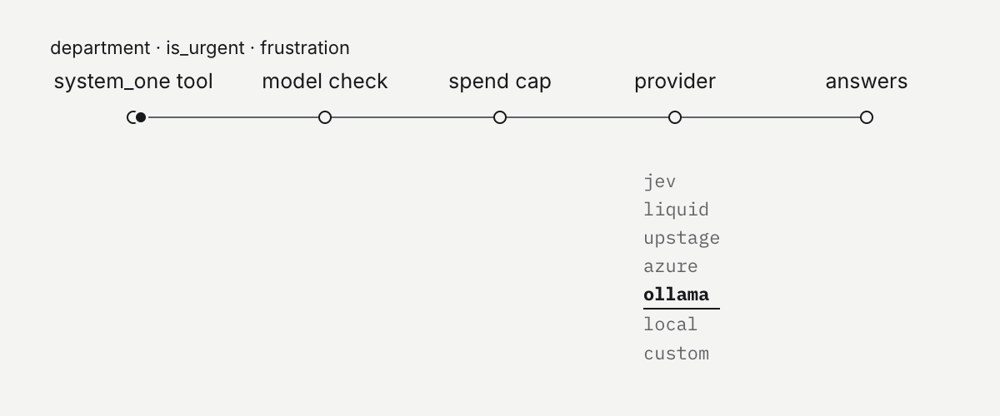
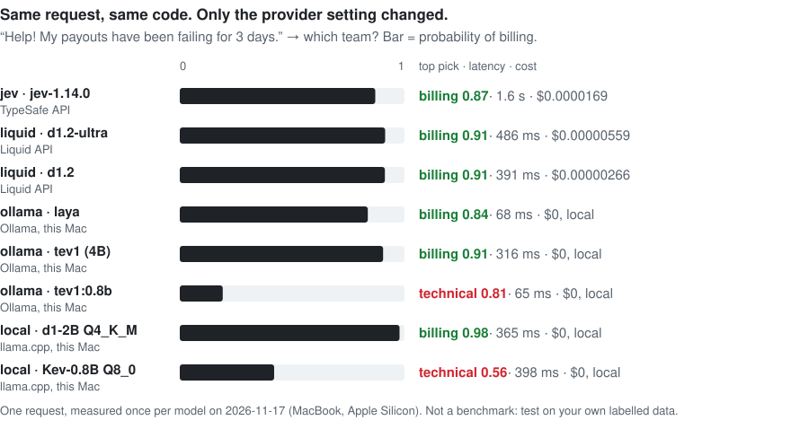

# system-one

**One tool for every System One decision model. Switch the provider, keep the code.**


<sub>Real answers from one request, measured once per model on 2026-11-17 through this plugin. Not a benchmark.</sub>

A [Hermes Agent](https://github.com/NousResearch/hermes-agent) plugin for typed judgments with
calibrated probabilities: TypeSafe Jev, Liquid d1.2, Upstage Solar Decide, Microsoft-Decision-1,
or open models such as Laya and Tev1 running in Ollama on your own machine.

[Providers](#providers) · [Install](#install) · [Run it on your own machine](#run-it-on-your-own-machine) · [Configure](#configure) · [Use](#use) · [Key safety](#key-safety) · [Limits](#known-limits)

## The problem

Decision models answer questions like "which team owns this ticket?" or "is this message
urgent?" in one forward pass, with a probability for every option. They are fast and cheap,
and there are now many of them: hosted APIs from TypeSafe, Liquid, Upstage and Microsoft, and
open models you can run on a laptop.

They all speak the same contract, `POST /v1/systemone`, but each one ships with its own SDK,
host, auth header, model names and limits. So trying a second provider usually means new code,
a new key in a new place, and no shared view of what you have spent. A request with a question
type the model doesn't support is often billed before it fails.

system-one puts them all behind one tool. The provider is a setting.

## What it does



| | |
|---|---|
| **One tool, seven providers** | The agent calls `system_one` with a `state` and typed `questions` (`noul`, `choice`, `score`, plus whatever else the model supports). It gets the provider's answers back unchanged. |
| **Provider is a setting** | `provider` and `model_name` are read on every call. Change them in Desktop or with `hermes config set` and the next request goes to the new model. No restart, no code change. |
| **Model check before sending** | Each model's question types and limits are known: Laya takes 64 questions and 26 options, Liquid d1.2 takes text and spans, Jev doesn't. A request that can't work is refused before it is sent, so it costs nothing. |
| **Spend caps before every call** | Total, daily and per-call caps in USD, checked against a local SQLite ledger before the request goes out, then recorded with the real token count. |
| **Keys stay with their provider** | A Liquid key only ever goes to `api.liquid.ai`, an Upstage key only to Upstage's hosts, and so on. One changed setting can't send a key somewhere else. [Details](#key-safety). |
| **Local models are free** | `ollama` and `local` run on your machine: no key, no bill, and with `localhost` nothing leaves the machine. |
| **`/system-one`** | Shows the active provider, model, endpoint, price, spend against each cap, and which keys are set. |
| **Bundled skill** | `system-one:system-one` teaches the agent to write questions that hold up: judgments from the model, decisions in code. |

## Providers

| `provider` | What it is | Models | Price / 1M input | Key | Status |
| --- | --- | --- | --- | --- | --- |
| `jev` (default) | TypeSafe API | `jev-1.14.0` | $0.042 | `TYPESAFE_API_KEY` | tested live |
| `liquid` | Liquid AI API | `d1.2-ultra` (default), `d1.2` | $0.042 / $0.02 | `LIQUID_API_KEY` | tested live |
| `upstage` | Upstage Solar Decide (global or Korea region) | `solar-decide` (default), `solar-decide-flash` | $0.10 / not published | `UPSTAGE_API_KEY` | from docs |
| `azure` | Microsoft-Decision-1 on your Azure AI Foundry resource | your deployment name | $0.042 | `AZURE_FOUNDRY_API_KEY` | from docs |
| `ollama` | Open models in Ollama on your machine | `laya` (default), `tev1`, `tev1:0.8b`, … | free | none | tested live |
| `local` | Any self-hosted server, such as llama.cpp | whatever your server runs | free | optional | tested live |
| `custom` | Any other hosted System One endpoint | yours | you set it | `SYSTEM_ONE_API_KEY` | unit tests |

Prices were checked on 2026-11-17 on each provider's own pages; confirm them before you rely on
the caps. "From docs" means built and unit-tested against the provider's published API but not
called live, because we don't hold a key for it.

### Same request, every provider

<picture>
  <source media="(prefers-color-scheme: dark)" srcset="docs/providers-dark.svg">
  
</picture>

**Read this as one example, not a ranking.** Each model answered the docs example once. The
point is the shape: the same request and code ran on every model, and the answers can be
compared directly. The two smallest models (0.8B) picked a different team, which is exactly why
you should run your own labelled examples before you switch. Raw numbers:
[`launch/measurements.json`](launch/measurements.json). Chart: `python3 launch/make_chart.py`.

## Install

```bash
hermes plugins install salismt/hermes-system-one
hermes plugins enable system-one
```

Then pick a provider and add its key (next sections). The tool stays hidden until the active
provider is usable, so the agent never offers a tool that can't run. Needs Hermes 0.23 or later.
No other dependencies: the client uses only the Python standard library.

For local development, clone this repo into `~/.hermes/plugins/system-one` and run
`hermes plugins enable system-one`.

## Run it on your own machine

Run a decision model locally and nothing leaves your network or gets billed.

### Ollama: Laya and Tev1 (recommended)

Ollama serves decision models on its own `/v1/systemone` endpoint, so there is no separate
server to install.

```bash
ollama pull laya                 # 846 MB · Convai Innovations · Apache 2.0 · needs Ollama 0.40+
ollama pull tev1                 # 4.4 GB · Together AI · Qwen3.5-4B fine-tune · needs Ollama 0.35+
ollama pull tev1:0.8b            # 1.5 GB · the small Tev1, for tight memory

hermes config set plugins.entries.system-one.settings.provider ollama
hermes config set plugins.entries.system-one.settings.model_name tev1   # blank = laya
```

Ollama runs in the background on `http://127.0.0.1:11434`, the plugin's default, so there's no
URL to set. Check the version with `ollama --version`.

| Model | Size | Good for | Notes |
| --- | --- | --- | --- |
| `laya` | 421M | Routing, moderation, email triage | English only. Each question gets a 512-token budget covering instructions, options and state; longer states are truncated. Tags: `laya:421m-english-bf16`, `laya:421m-typed-decisions-bf16`, `laya:322m-multilingual-bf16` (100+ languages), and `-mlx-fp16` builds for Apple Silicon. |
| `tev1` | 4B | Policy checks, routing by rules | Context of about 2,000 tokens. Trained on 2 to 24 options; stay in that range. |
| `tev1:0.8b` | 0.8B | Tight memory budgets | Less accurate than the 4B model. |

Both answer `noul`, `choice` and `score`, take 1 to 64 questions per request, 2 to 26 options or
levels, and request bodies up to 64 KiB. The plugin checks all of that before sending. For any
other decision model you pulled, set `model_name` to its name; unknown models aren't checked,
and Ollama's own error comes back as a provider error.

Laya's and Tev1's `confidence` is how concentrated the probabilities are, not the chance the
answer is right. Re-check any confidence threshold you carry over from a hosted model.

### llama.cpp: any GGUF decision model

`llama-server` has served `/v1/systemone` since llama.cpp 0.6.0. Homebrew may still have an
older build (`brew upgrade llama.cpp`).

```bash
llama-server -hf LiquidAI/d1-2B-GGUF:Q4_K_M --port 8080   # Liquid's open-weight d1, 1.1 GB
llama-server -hf ggml-org/Kev-0.8B-GGUF:Q8_0 --port 8080  # 812 MB
llama-server -m ./d1-2B-Q4_K_M.gguf --port 8080           # a .gguf you already have

hermes config set plugins.entries.system-one.settings.provider local   # default http://127.0.0.1:8080
```

Decision models with published GGUFs include `ggml-org/Kev-4B-GGUF`, `ggml-org/Kev-0.8B-GGUF`,
`ggml-org/Julia-1-GGUF` (144M, 50+ languages), `ggml-org/Laya-GGUF`, `ggml-org/Clef-GGUF`,
`LiquidAI/d1-2B-GGUF`, `LiquidAI/d1-Omni-2B-GGUF` and `LiquidAI/d1-omni-600M-GGUF`. llama.cpp
answers `noul`, `choice` and `score`. Liquid's extraction types (text, number, spans, boxes)
need the Liquid API. To serve several models from one server, run `llama serve` with no model
and set `model_name`, e.g. `ggml-org/Kev-4B-GGUF:Q8_0`.

### Running the model on another machine

Plain `http://` is accepted only for `localhost`, `127.0.0.1` and `::1`, so your text never
crosses a network unencrypted. For a GPU box elsewhere, either put it behind HTTPS (Caddy or
nginx with a certificate) and set `base_url` to `https://…`, or tunnel it and keep the default:

```bash
ssh -N -L 11434:127.0.0.1:11434 gpu-box     # Ollama
ssh -N -L 8080:127.0.0.1:8080 gpu-box       # llama.cpp
```

If the server sits behind an auth proxy, enter its token as **Self-hosted server key**
(`SYSTEM_ONE_LOCAL_API_KEY`). It's sent as a bearer token, only to the `base_url` you set.

### Before you rely on a local model

Open models vary a lot. In the chart above, two of the five local models (both 0.8B) picked the
wrong team on the docs example. Run your own labelled examples through a hosted model and a local one
before switching a production workflow. With `allow_provider_override` on, the agent can send
one call to another provider, which makes that comparison a one-line change.

## Configure

All settings live under `plugins.entries.system-one.settings`. Desktop shows them as a form under
**Settings > Plugins > system-one**. From the CLI:

```bash
hermes config set plugins.entries.system-one.settings.provider liquid
hermes config set plugins.entries.system-one.settings.model_name d1.2          # blank = provider default

# caps in USD: -1 = no cap, 0 = block every call
hermes config set plugins.entries.system-one.settings.total_cap_usd 5
hermes config set plugins.entries.system-one.settings.daily_cap_usd 0.5
hermes config set plugins.entries.system-one.settings.per_call_cap_usd 0.05
hermes config set plugins.entries.system-one.settings.cap_utc_offset_hours 7   # which day "daily" means
```

| Setting | Default | Meaning |
| --- | --- | --- |
| `provider` | `jev` | `jev`, `liquid`, `upstage`, `azure`, `ollama`, `local` or `custom` |
| `model_name` | blank | Blank = the provider's default. Required for `azure` (your deployment name) and `custom` |
| `base_url` | blank | `azure`: your Foundry resource. `ollama`/`local`: your server, if not the default. `upstage`: optional Korea region. `custom`: required. Fixed for `jev` and `liquid` |
| `usd_per_mtok` | `0` | Price per 1M input tokens. `0` = the built-in list price (local models are free). Required for `custom` |
| `total_cap_usd` | `5.0` | All-time cap across providers |
| `daily_cap_usd` | `0.5` | Cap per calendar day |
| `per_call_cap_usd` | `0.05` | Refuses any single request estimated above this |
| `cap_utc_offset_hours` | `0` | Timezone that decides which calendar day the daily cap counts |
| `allow_provider_override` | `false` | Let the agent send a single call to another provider whose key is set |
| `timeout_s` | `90` | Request timeout |
| `log_payloads` | `false` | Append requests and answers to `payloads.jsonl` (the state may be private) |

### API keys

Keys are secrets, so they go in `~/.hermes/.env`, never in `config.yaml`. In Desktop, enter them in
the masked fields on the plugin's settings page. From a shell, add the line to `~/.hermes/.env`:

```bash
TYPESAFE_API_KEY=...          # jev
LIQUID_API_KEY=...            # liquid (console.liquid.ai > Dashboard > API Keys)
UPSTAGE_API_KEY=...           # upstage (console.upstage.ai > API Keys)
AZURE_FOUNDRY_API_KEY=...     # azure (your deployment's details page)
SYSTEM_ONE_LOCAL_API_KEY=...  # ollama / local, only behind an auth proxy
SYSTEM_ONE_API_KEY=...        # custom
```

### Azure: Microsoft-Decision-1

1. In Azure AI Foundry, deploy **Microsoft-Decision-1** from the model catalog.
2. From the deployment's details page, copy the **resource endpoint**, the **deployment name** and
   the **API key**.
3. Configure the plugin, then enter the key as **Azure AI Foundry API key**:

```bash
hermes config set plugins.entries.system-one.settings.provider azure
hermes config set plugins.entries.system-one.settings.base_url https://<resource>.services.ai.azure.com
hermes config set plugins.entries.system-one.settings.model_name <deployment-name>
```

The plugin calls `<resource>/providers/microsoft/v1/systemone` with the `api-key` header. Use the
bare resource endpoint (no project path, no `/openai`); a pasted full endpoint is trimmed for you.
Microsoft Entra ID tokens aren't supported yet.

## Use

Ask the agent in plain language ("classify these tickets by team with system_one"), or have it
call the tool directly:

```json
{
  "state": "Help! My payouts have been failing for 3 days.",
  "questions": {
    "department": {"type": "choice", "instructions": "Which team should handle this?",
                   "criteria": {"billing": "Payments, invoicing, refunds",
                                "technical": "Bugs, outages, integrations",
                                "sales": "Pricing, upgrades, new accounts"}},
    "is_urgent": {"type": "noul", "instructions": "Does this convey urgency?"},
    "frustration": {"type": "score", "instructions": "How frustrated is the customer?",
                    "criteria": ["Calm", "Frustrated", "Very angry"]}
  }
}
```

Result (real `jev-1.14.0` response, trimmed):

```json
{"provider": "jev", "model": "jev-1.14.0",
 "answers": {"department": {"type": "choice", "choice": "billing", "probabilities": {"billing": 0.87, "technical": 0.13, "sales": 0.0}},
             "is_urgent": {"type": "noul", "noul": 0.94},
             "frustration": {"type": "score", "score": 1.02, "probabilities": {"0": 0.0, "1": 0.98, "2": 0.02}}},
 "usage": {"input_tokens": 402}, "usd": 1.688e-05}
```

Optional arguments: `dry_run: true` estimates tokens and cost and sends nothing; `model`
overrides the model for one call; `provider` sends one call to another provider (refused unless
`allow_provider_override` is on, because you decide which vendor gets your data); `tag` labels
the call in the spend ledger.

Errors come back as `{"error": ..., "kind": "unsupported" | "budget_exceeded" | "provider_error" | "invalid_request"}`
and are never turned into an answer. For example:

```text
unsupported      question 'invoice': type 'text' is not supported by ollama/laya (supported: choice, noul, score)
budget_exceeded  per-call cap $0.00000001 (this call est. $0.00000449)
```

### From your own scripts

`system_one/` is a standard-library-only package with no Hermes imports, so a cron job or
service can use the same providers and caps:

```python
import os, sys
sys.path.insert(0, os.path.expanduser("~/.hermes/plugins/system-one"))
from system_one import SystemOne, Settings, Caps, noul, choice, score, simplify

s1 = SystemOne(Settings(provider="ollama", model="laya", caps=Caps(total_usd=5, daily_usd=0.5, per_call_usd=0.05)),
               ledger_path="spend.sqlite", get_key=os.environ.get)
r = s1.ask({"message": "Help! My payouts have been failing."},
           {"urgent": noul("Does `message` convey urgency?"),
            "team": choice("Which team should handle `message`?", {"billing": "Payments", "technical": "Bugs"}),
            "anger": score("How frustrated is the sender?", ["Calm", "Frustrated", "Very angry"])},
           tag="my-job")
print(simplify(r["answers"]))
```

The helpers `noul`, `choice`, `score`, `box` and `question` build plain dicts in the exact shape
the TypeSafe SDK sends, so no SDK is needed. SDK objects (`Choice`, `Noul`, `Score`) also work.
Don't use the SDK's own client against Liquid: as of typesafe-sdk 0.7.5 it raises on the missing
`x-typesafe-request-id` header after the call has been billed.

### What each model accepts

| Provider / model | Question types | Limits |
| --- | --- | --- |
| `jev` | noul, choice, score, box | |
| `liquid` `d1.2`, `d1.2-ultra` | noul, choice (+`multiple`), score, text, number, date, spans, box, boxes | 128 questions, 4.5 MB body |
| `liquid` `d1`, `d1.1`, `d1-ultra` (deprecated) | noul, choice, score | 128 questions, 4.5 MB body |
| `upstage` | noul, choice, score | 26 options per choice |
| `azure` | noul, choice, score | text only, 32,768 tokens (enforced by Azure) |
| `ollama` `laya*`, `tev1*` (any tag) | noul, choice, score | 64 questions, 26 options or levels, 64 KiB body |
| other `ollama` models, `local`, `custom` | not checked: depends on your server | not checked |

## The System One contract

A provider is compatible when it accepts

```text
POST {base_url}/v1/systemone            (Azure: /providers/microsoft/v1/systemone)
Authorization: Bearer <key>             (Azure: api-key: <key>; local servers: often none)
Content-Type: application/json

{"model": "...", "state": <string | object>, "questions": {"<id>": {"type": "...", ...}}}
```

and answers `200` with `{"model": "...", "usage": {"input_tokens": N}, "answers": {"<id>": {...}}}`.
To add a built-in provider, add an entry to `system_one/providers.py` and to `PROVIDERS` in
`__init__.py`, and a secret field to `plugin.yaml`. Tests keep the three in sync.

## Key safety

| What happens to a key | How |
| --- | --- |
| **Stored by Hermes, not the plugin** | Keys are `secret` settings in `~/.hermes/.env` (per profile), never in `config.yaml`. The plugin reads them only through Hermes's profile-scoped `get_secret()`. |
| **Sent only to its provider** | `TYPESAFE_API_KEY` → `api.typesafe.ai`; `LIQUID_API_KEY` → `api.liquid.ai` (`base_url` can't be changed for either). `UPSTAGE_API_KEY` → `api.upstage.ai` or `kr.api.upstage.ai`. `AZURE_FOUNDRY_API_KEY` → hosts ending in `.services.ai.azure.com`, `.cognitiveservices.azure.com` or `.openai.azure.com`. Only the dedicated `SYSTEM_ONE_LOCAL_API_KEY` and `SYSTEM_ONE_API_KEY` follow a `base_url` you choose. |
| **Encrypted in transit** | `https://` only; plain `http://` only to `localhost`, `127.0.0.1` or `::1`, matched exactly (`localhost.evil.com` is refused). No credentials, query or fragment in URLs. Redirects are errors, never followed. TLS verified. |
| **Never echoed** | Keys with whitespace or control characters are rejected with a message that doesn't contain them. Error bodies that contain the key are redacted and passed through Hermes's secret scrubber before the model sees them. |
| **Never stored by the plugin** | The spend ledger and optional payload log hold no headers and no keys. The payload log is created with mode `0600`. |
| **Small surface** | No dependencies, no self-update, no shell, no `eval`. Tests block all network access. |

## Known limits

- The agent runs with your permissions. An agent that can run shell commands can read
  `~/.hermes/.env` without this plugin. The plugin's guarantee is narrower: it adds no new path
  for a key to leave your machine.
- Caps use an estimate before sending (about 3 characters per token, so they trip early). Two calls
  at the same moment can both pass the check, so spend can go slightly over a cap. Set
  provider-side limits too where the provider offers them.
- Upstage and Azure are built from their published docs and unit-tested, but haven't been called
  live by the maintainer.
- Calibration is measured by each vendor on their own benchmarks. A probability of 0.9 doesn't mean
  the answer is right 90% of the time on your data; test thresholds on your own examples.
- Keep high-stakes decisions in code. Use the model for the judgment, not as the only check.

## Privacy and cost

- The `state` and `questions` go only to the selected provider: TypeSafe, Liquid AI, Upstage,
  your Azure Foundry resource, your own server, or your custom endpoint. With `ollama` or `local`
  on `localhost`, nothing leaves the machine.
- Hosted requests are billed to your account with that provider, on input tokens only. The caps
  use an estimate before sending and the reported `usage.input_tokens` after.
- The ledger (`spend.sqlite`) and optional payload log live in `~/.hermes/plugin-data/system-one/`,
  outside the plugin folder, so they survive updates.
- The plugin never updates itself. Updates arrive only through `hermes plugins update`.

## Develop

```bash
python -m pytest -q                                   # unit tests, no network
hermes plugins validate . --install-deps              # same check the catalog CI runs
hermes plugins doctor . --ci
python3 launch/make_chart.py                          # README chart from launch/measurements.json
```

`launch/` holds the README graphics: `FACTS.md` (the only text allowed on screen), the HyperFrames
projects for the GIFs, and the chart script. It isn't part of the plugin.

## License

MIT. The bundled skill is adapted from TypeSafe's `typesafe-ai` skill (MIT, (c) 2026 TypeSafe AI).
See [LICENSE](LICENSE).
